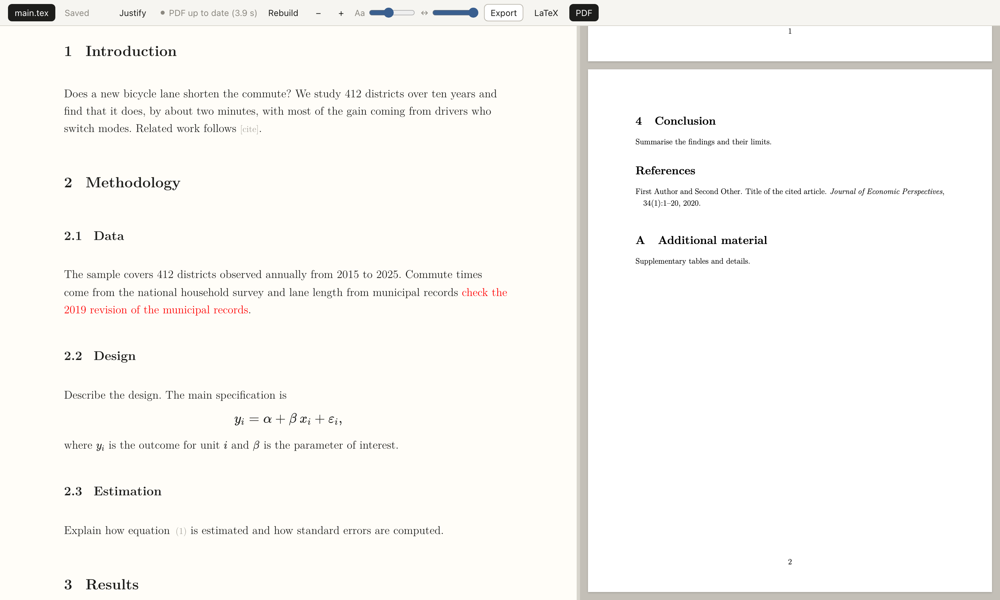

# ltx

A local browser editor for LaTeX papers that you and Claude Code can edit at the same time.



Site: <https://danieldager.github.io/ltx/>

## Why

When Claude Code edits a `.tex` file while you have it open in an editor, one of you
loses work: the editor reloads over your typing, or your save overwrites the edit. ltx
treats the file on disk as the shared document. Your keystrokes stay local and are
saved as small patches; edits that arrive from outside are merged into the open buffer
within about a second, around whatever you have typed. You keep working in the browser,
Claude keeps working in the terminal, and the PDF rebuilds in the background.

## Features

- Source buffer (CodeMirror 6) set in an economics-paper look: Latin Modern type, one
  paragraph per line, section numbers, citation and reference chips, KaTeX math and HTML
  tables when you switch the LaTeX view off.
- Surgical saves: opening and saving a file without changes writes zero bytes; changing
  one word changes one line.
- Live merging of external edits; if you both touch the same characters, the file on disk
  wins and your replaced text is shown so you can re-insert it.
- Background PDF with tectonic, shown beside the source; errors are explained in plain
  words and the last good PDF stays on screen.
- Selection, comments and suggestions are written to `.ltxed/` next to your paper, where
  Claude Code reads them.
- Multi-file papers (`\input`, `\include`), appendix numbering across files.
- Everything runs on `127.0.0.1`; there is no account, cloud or telemetry.

## Install

Needs Python 3.11+, [uv](https://docs.astral.sh/uv/) and
[tectonic](https://tectonic-typesetting.github.io/):

```
brew install tectonic
uv tool install git+https://github.com/danieldager/ltx
```

Without installing: `uvx --from git+https://github.com/danieldager/ltx ltx --help`.

## Use

```
ltx new paper/            # create paper/main.tex and references.bib from a template
ltx open paper/main.tex   # start the server and open the browser (a second open reuses it)
ltx stop paper/           # stop the server for that folder
```

`ltx open` prints the URL and logs to `paper/.ltxed/server.log`. Add `.ltxed/` to your
`.gitignore`.

## Use with Claude Code

Install the skill once:

```
ltx setup-claude              # writes ~/.claude/skills/ltx/SKILL.md (idempotent)
ltx setup-claude --uninstall
```

With a paper open in ltx, talk to Claude Code in the terminal as usual. The skill makes
Claude read the files ltx keeps in `.ltxed/`:

| File | Written by | Use |
|---|---|---|
| `selection.json` | ltx, on every selection change | "rewrite this paragraph", "shorten the selected table caption" |
| `comments.json` | ltx (you), Claude (status and reply) | select text, add a comment, then say "do the comments" |
| `suggestions.json` | Claude | edits Claude proposes; you accept, reject or discuss each in the editor |
| `compile_errors.json` | ltx, after each build | "fix the build" |

Claude edits the `.tex` files directly with surgical `Edit` calls, one paragraph per
line, and checks `compile_errors.json` after each change.

To have Claude pick up comments as you write them, ask it to monitor. In Claude Code this
uses the Monitor tool with this command:

```
ltx watch paper/main.tex
```

`ltx watch` prints one line per newly opened comment (`<id> <file>:<line> <instruction>`)
and nothing otherwise, so each line wakes Claude, which applies the comment, sets its
`status` and `reply`, and goes back to waiting. Add `--skip-existing` to ignore comments
that are already open.

## Develop

```
git clone https://github.com/danieldager/ltx && cd ltx
uv sync
uv run pytest tests -q      # headless Chromium via Playwright; needs tectonic
cd web && npm install && npm run build   # rebuilds src/ltx/static/
```

The built frontend in `src/ltx/static/` is committed, so installing from git needs no
Node. `SPEC.md` has the design and the frozen protocol; `HANDOFF.md` has build notes.

## Status and limits

A personal tool, tested on macOS only (the tests assume `Meta+` shortcuts and a Homebrew
tectonic). Known limits:

- No CRLF or BOM handling; files must be UTF-8 with LF line endings.
- Characters outside the Basic Multilingual Plane can desync offsets.
- Undefined reference and citation warnings are not linked to a file.
- Section numbering across `\input` files is computed by the editor and can differ from LaTeX.
- On launch the server builds and overwrites `<name>.pdf` next to the source.

## License

MIT, see `LICENSE`. Bundled third-party files (Latin Modern fonts under the GUST Font
License, KaTeX under MIT, pdf.js under Apache 2.0, CodeMirror under MIT) are listed there.
